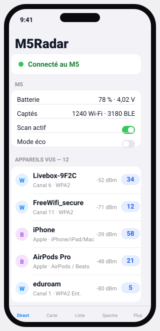
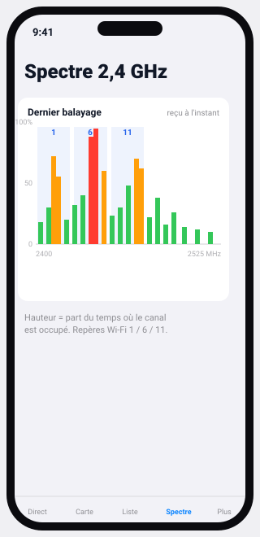
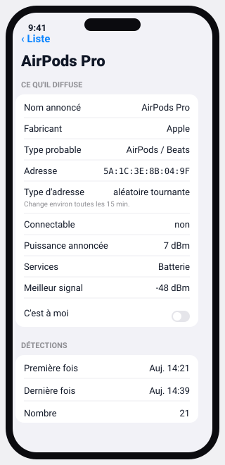
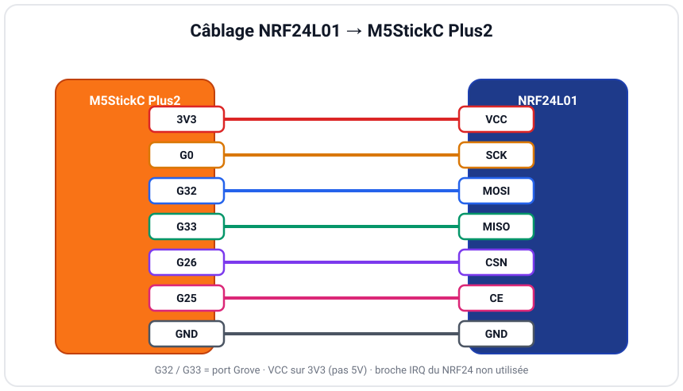

# M5Radar

Collecteur **passif** de signaux Wi-Fi et Bluetooth (BLE) pour **M5StickC Plus2**,
avec analyse du spectre 2,4 GHz via un module **NRF24L01**, relié par Bluetooth à une
**app iPhone** (SwiftUI) qui horodate, géolocalise, stocke et exporte les données.

But : voir ce que les appareils autour de soi diffusent publiquement, et ce que l'on
diffuse soi-même. Projet personnel / pédagogique.

> ⚠️ **Écoute seule.** M5Radar observe ; il n'attaque pas. Pas de déauthentification,
> pas de brouillage, pas de *spam* de balises, pas d'usurpation de réseaux. Voir la
> section [Cadre légal](#cadre-légal-et-éthique).

---

## Aperçu de l'app

> Interface présentée avec des **données d'exemple** (les vraies captures
> contiendraient des SSID et adresses MAC réels, qui n'ont pas leur place en public).

<p align="center">
  
  
  
</p>

---

## Fonctionnalités

- **Scan Wi-Fi passif** : SSID, BSSID, canal, sécurité (ouvert/WEP/WPA/WPA2/WPA3), RSSI.
- **Scan BLE** : adresse et type (publique / aléatoire tournante), nom, fabricant,
  type probable (iPhone, AirPods, AirTag, Tile…), services, puissance d'émission, RSSI.
- **Spectre 2,4 GHz** (NRF24L01) : occupation des 126 canaux, repères Wi-Fi 1/6/11 et BLE.
- **Liaison BLE chiffrée et appairée** (code à 6 chiffres affiché sur le M5).
- **Tampon hors ligne** : le M5 stocke en flash (LittleFS) quand l'iPhone est absent,
  puis vide tout à la reconnexion.
- **App iPhone** : vue en direct, carte (MapKit), liste/recherche, spectre (Swift Charts),
  « Mes appareils » (repérer ses propres appareils), export **CSV** et **GeoJSON**.
- **Émission de test, désactivée par défaut** : sa propre balise BLE (message court) et
  un point d'accès Wi-Fi de test (qui **refuse** de reprendre le nom d'un réseau voisin).

---

## Matériel

- M5StickC Plus2 (ESP32-PICO-V3-02, 8 Mo de flash)
- Module NRF24L01 (optionnel, pour le spectre 2,4 GHz)
- iPhone sous iOS 17 ou plus

### Câblage du NRF24L01

Le bus d'affichage du M5 est sur VSPI ; le NRF24 utilise HSPI via la matrice GPIO.



| NRF24 | M5StickC Plus2 |
|-------|----------------|
| SCK   | G0             |
| MOSI  | G32 (Grove)    |
| MISO  | G33 (Grove)    |
| CSN   | G26            |
| CE    | G25            |
| VCC   | 3V3            |
| GND   | GND            |

Les broches sont modifiables dans [`firmware/include/config.h`](firmware/include/config.h).
Si le câblage diffère, l'outil [`tools/nrf_probe`](tools/nrf_probe) les retrouve
automatiquement (voir plus bas).

---

## Firmware (M5StickC Plus2)

Nécessite [PlatformIO](https://platformio.org/) (`brew install platformio`).

```bash
cd firmware
pio run                                   # compiler
pio run -t upload --upload-port /dev/cu.usbserial-XXXX   # flasher
pio device monitor                        # journal série (115200 bauds)
```

> 💾 **Sauvegarde conseillée avant le premier flash** (restaure Bruce, UIFlow, etc. ensuite) :
> ```bash
> esptool.py --port /dev/cu.usbserial-XXXX --baud 921600 read_flash 0 0x800000 backup.bin
> # restauration : esptool.py --port ... write_flash 0 backup.bin
> ```
> Ces sauvegardes ne sont pas versionnées (elles contiennent les clés de l'appareil).

### Trouver le câblage du NRF24

```bash
cd tools/nrf_probe
pio run -t upload --upload-port /dev/cu.usbserial-XXXX
pio device monitor
```
Le sketch teste les combinaisons de broches et affiche celle qui répond, à recopier
dans `firmware/include/config.h` (mettre `NRF_ENABLED 1`).

---

## App iPhone

Nécessite Xcode 16+ et [XcodeGen](https://github.com/yonaskolb/XcodeGen) (`brew install xcodegen`).

```bash
cd ios
xcodegen generate          # génère M5Radar.xcodeproj depuis project.yml
open M5Radar.xcodeproj
```

Dans Xcode : onglet **Signing & Capabilities** → choisis ton équipe (*Team*), branche
ton iPhone, puis **Run**.

- Avec un **identifiant Apple gratuit**, l'app est signée pour **7 jours** ; il faut la
  réinstaller depuis Xcode ensuite.
- Autorise **Bluetooth** et la **localisation « Toujours »** (pour géolocaliser les
  détections faites iPhone en poche).
- Au premier appairage, saisis sur l'iPhone le **code à 6 chiffres** affiché par le M5.

---

## Données collectées

Tout reste **sur l'iPhone** (SwiftData). Rien n'est envoyé ailleurs, sauf si tu exportes
toi-même (CSV / GeoJSON via la feuille de partage iOS).

Le protocole binaire M5 ↔ iPhone est décrit dans
[`firmware/include/protocol.h`](firmware/include/protocol.h) et reflété dans
[`ios/M5Radar/Protocol.swift`](ios/M5Radar/Protocol.swift).

---

## Cadre légal et éthique

- **Écoute passive.** Scanner les émissions publiques Wi-Fi/BLE est comparable à écouter
  ce qui passe à portée. Le projet **n'inclut volontairement aucune capacité offensive**
  (déauthentification, brouillage, *spam* de balises/BLE, portail captif, usurpation).
- **Brouillage interdit.** En France, détenir ou utiliser un brouilleur radio est illégal
  (Code des postes et communications électroniques, contrôlé par l'ANFR), même chez soi.
- **Données personnelles.** Une adresse MAC peut être une donnée personnelle (RGPD). Garde
  les captures pour un usage strictement personnel ; ne les publie pas, ne pistes personne.
- **À utiliser sur tes propres réseaux/appareils**, ou pour de la simple observation de
  l'environnement radio.

---

## Licence

[MIT](LICENSE).
